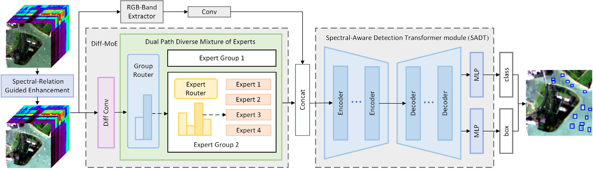
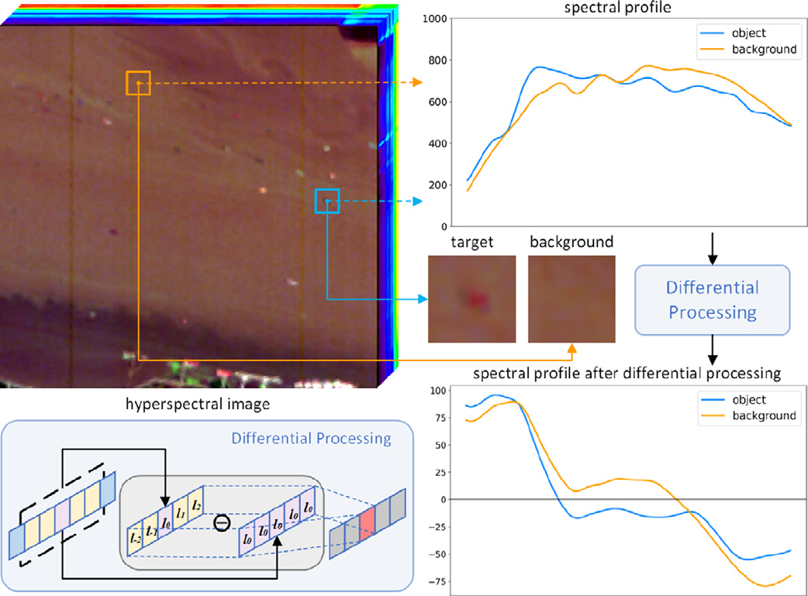
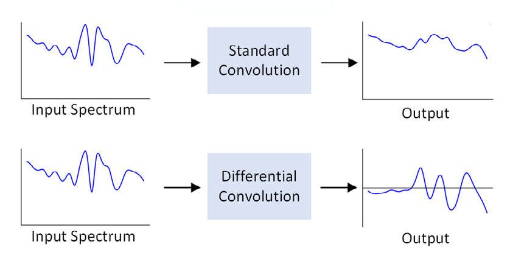
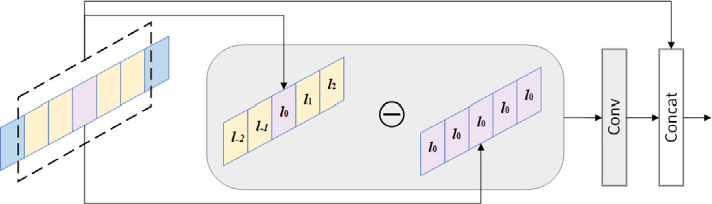
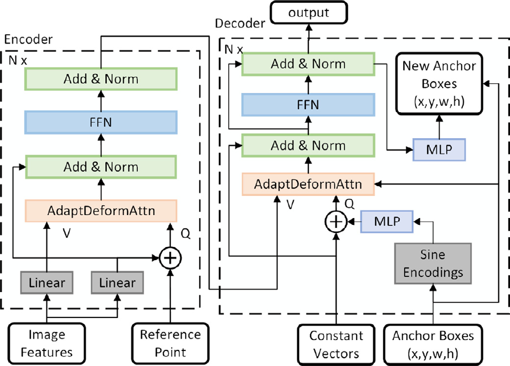
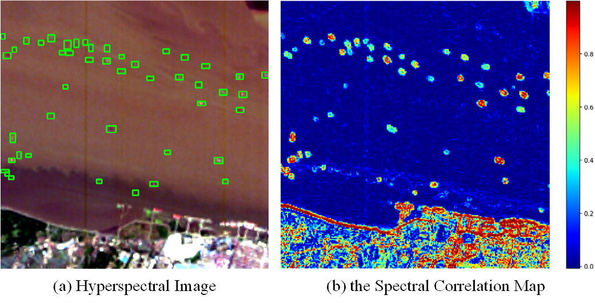
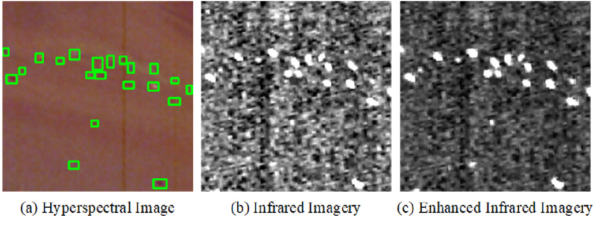

<div align="center">

# DCH-Net

**DCH-Net: A hyperspectral object detection network with differential convolution and spectral gradient fusion**

Ailin Niu · Xinyu Yan · Qiang Wang<sup>*</sup> · Jiuchen Chen · Xiaolin Han · Qizhi Xu

School of Mechatronics Engineering, Beijing Institute of Technology

Pattern Recognition, Volume 180, 2026, Article 113956

[Paper](https://www.sciencedirect.com/science/article/pii/S0031320326009210) · [DOI](https://doi.org/10.1016/j.patcog.2026.113956) · [Dataset](https://huggingface.co/datasets/fengyanzi/SHD25) · [Code](https://github.com/nal793/DCH-Net)

<sup>*</sup> Corresponding author

</div>

DCH-Net detects small ships in hyperspectral imagery by modeling local spectral change together with spatial context. This repository presents the method. SHD-25 is released separately; see [data/README.md](data/README.md) for what it contains and how to download it.

## Abstract

Hyperspectral remote sensing images provide rich spectral information, making them widely used in downstream tasks such as object detection. However, existing detection methods often struggle to capture local variations along the spectral dimension, limiting the full exploitation of spectral information. To address this issue, we propose Differential Convolution-based Hyperspectral detection Network (DCH-Net) to effectively exploit the differential information in hyperspectral images. First, we design a Dual Path Diverse Mixture of Experts module to dynamically integrate the original channels with differential information. Second, we develop an Adaptive Deformable Attention mechanism that incorporates the image content of reference points into sampling position prediction, enabling effective use of local contextual information. In addition, considering the limited quantity and scene coverage of existing hyperspectral object detection datasets, we construct a hyperspectral ship detection dataset named SHD-25. A spectral-correlation-based target enhancement strategy is also introduced to further improve small target detectability. Experimental results demonstrate that our method outperforms existing approaches across multiple benchmarks, indicating its effectiveness for hyperspectral object detection. The source code and dataset will be publicly available at <https://github.com/nal793/DCH-Net>.

## Highlights

- **Spectral gradients are an explicit feature.** When a ship and the surrounding water have similar spectral shapes, the differential response still separates them by the sign and magnitude of band-to-band change.
- **Original spectra and differential spectra are modeled by different experts.** One expert group uses standard 1D convolution for local patterns. The other uses dilated 1D convolution for a wider spectral context. A two-stage router picks the group, then one expert inside it.
- **Sampling locations follow the image content.** Adaptive deformable attention predicts offsets from the query and from features gathered around the reference point. A spectral gate reweights those samples so weak ships stay visible against spectrally similar backgrounds.
- **One annotation serves both kinds of detectors.** `hsi/` stores the 242-band cube. `rgb/` stores an RGB quicklook for conventional detectors. `labels/` stores YOLO boxes for the ship class.

## Method


### Overview



*Figure 2. DCH-Net. The upper stream encodes RGB bands. The lower stream applies SRGE and Diff-MoE. SADT predicts the class and the box.*

### Differential convolution




*Figure 1. A ship pixel and a background pixel have similar raw spectra. After differentiation, the two curves separate.*



*Figure 3. The same input spectrum after standard 1D convolution and after differential convolution.*



*Figure 4. Diff-Conv subtracts the center band, applies convolution, and concatenates the result with the original local spectrum.*

### Dual-path mixture of experts

At each pixel the original spectrum and the differential spectrum are concatenated and sent to the Dual Path Diverse Mixture of Experts.

- Group 1 applies standard 1D convolution and captures local spectral patterns.
- Group 2 applies dilated 1D convolution and captures a wider spectral context.
- Each group contains experts with different kernel widths.

Routing has two stages. A group router scores the expert groups. An expert router then selects one expert inside the chosen group (top-1). The selected expert transforms the concatenated spectrum.

### Spectral-aware detection transformer




*Figure 5. SADT. Offsets depend on image features and the reference point. The decoder refines anchor boxes layer by layer.*

### Spectral-relation guided enhancement

SRGE is the preprocessing step on the spectral branch. Ships tend to keep a stable response across wavelength, while the sea surface, dominated by specular reflection, has weaker band-to-band correlation. The cube is divided into patches. Inside each patch the correlation coefficient between every pair of bands is

\[
\rho_{ij}=\frac{\mathrm{Cov}(X_i,X_j)}{\sigma_i\sigma_j}
\]

The mean of the off-diagonal entries is the raw spectral correlation \(C_{\text{raw}}\) at that location. After normalization and an offset \(\alpha\), the map multiplies an infrared band:

\[
\hat C=\alpha+\frac{C_{\text{raw}}-C_{\min}}{C_{\max}-C_{\min}},\qquad F=\hat C\cdot I
\]

Sea clutter is darkened and ships become brighter, while the spatial layout of the scene stays in place.



*Figure 6. Green boxes mark ships. Correlation is low on the sea, high on land, and intermediate on ships.*



*Figure 7. Ships in the infrared band before and after spectral-relation guided enhancement.*

## SHD-25

SHD-25 is the hyperspectral ship detection set used with DCH-Net. It contains 120 chips of \(256\times256\) pixels from EO-1 Hyperion, covering coastal and harbor scenes in China, Singapore, Panama, South Korea, Nigeria, the Netherlands, and the United States. Download it from <https://huggingface.co/datasets/fengyanzi/SHD25>. Instructions are in [data/README.md](data/README.md). The dataset archive carries the full file-level description.

```text
SHD25/
├── hsi/          # 120 uint16 TIFF cubes, 256×256×242
├── rgb/          # 120 PNG quicklooks for conventional detectors
├── labels/       # 120 YOLO label files, class 0 = ship
├── previews/     # 120 JPEG previews with yellow ground-truth boxes
├── shd25.yaml
├── classes.txt
└── meta/index.csv
```

`shanghai_01` is one sample across all four folders: `hsi/shanghai_01.tif`, `rgb/shanghai_01.png`, `labels/shanghai_01.txt`, and `previews/shanghai_01.jpg`.

Each label row is `class cx cy w h`, with the box center, width, and height normalized by 256. The first lines of `shanghai_01` are:

```text
0 0.375 0.859376 0.046876 0.039062
0 0.482422 0.642578 0.035156 0.035156
```

The set has 786 ship boxes, from 1 to 43 per chip. Most ships occupy a small footprint, on the order of 10 to 100 pixels.

| Scene | Location | Images | Boxes |
| --- | --- | ---: | ---: |
| shanghai | Shanghai, China | 23 | 264 |
| hongkong | Hong Kong, China | 16 | 58 |
| singapore | Singapore | 32 | 178 |
| singapore2 | Singapore, second scene | 23 | 194 |
| panama | Panama | 11 | 26 |
| busan | Busan, South Korea | 4 | 9 |
| lagos | Lagos, Nigeria | 1 | 4 |
| rotterdam | Rotterdam, the Netherlands | 4 | 26 |
| losangeles | Los Angeles, United States | 4 | 23 |
| ship5 | ship5 | 2 | 4 |

Yellow boxes are drawn only in `previews/`. Training uses `labels/`. Each cube is an uncompressed TIFF of shape `(256, 256, 242)` and dtype `uint16`, with bands along the last axis. DCH-Net uses the calibrated subset `[8–56, 81–118, 132–162, 187–213]`, 145 bands in total.

```bash
pip install -r requirements.txt
```

```python
from shd25 import SHD25, select_paper_bands

dataset = SHD25("SHD25")  # directory from data/README.md
sample = dataset[0]
cube = select_paper_bands(sample["hsi"])

print(sample["id"], sample["file_name"])
print(sample["hsi"].shape, cube.shape)   # (256, 256, 242), (256, 256, 145)
print(sample["boxes"][:2])                # cx, cy, w, h
```

`dataset.get("panama_01")` loads a sample by file name or by `sample_id`. For a conventional detector, point the loader at `rgb/` and `labels/`. `shd25.yaml` is the matching YOLO config.

## Citation

```bibtex
@article{niu2026dchnet,
  title   = {DCH-Net: A hyperspectral object detection network with differential convolution and spectral gradient fusion},
  author  = {Niu, Ailin and Yan, Xinyu and Wang, Qiang and Chen, Jiuchen and Han, Xiaolin and Xu, Qizhi},
  journal = {Pattern Recognition},
  volume  = {180},
  pages   = {113956},
  year    = {2026},
  doi     = {10.1016/j.patcog.2026.113956}
}
```

## License and acknowledgements

Code in this repository is released under [Apache-2.0](LICENSE). SHD-25 — cubes, quicklooks, previews, boxes, and the index — is released under CC BY 4.0 with the dataset. Please cite the paper above when you use the method or the data.

